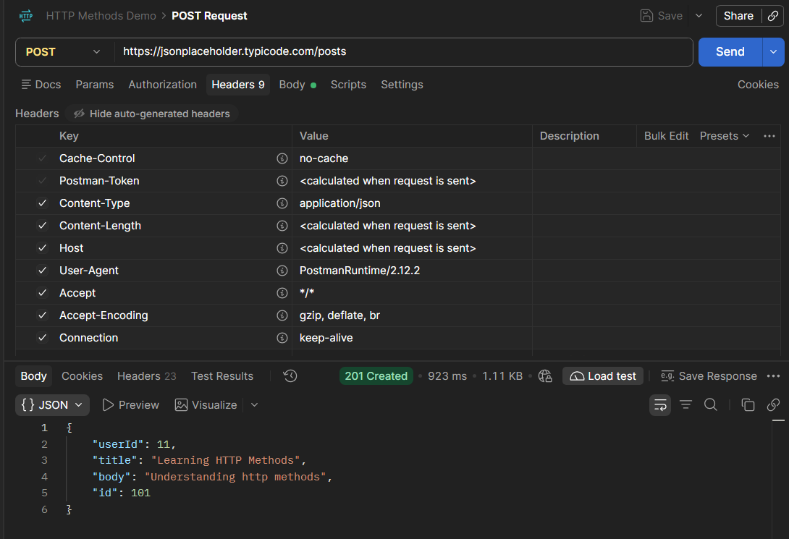

# Postman API Testing Practice

A hands-on REST API testing practice project using **Postman** and the **JSONPlaceholder** public REST API. This repository documents my practical learning of HTTP methods, API requests, headers, query parameters, and response validation.

## Project Overview

- **Project Type:** REST API Testing
- **Testing Tool:** Postman
- **API Provider:** [JSONPlaceholder](https://jsonplaceholder.typicode.com/)
- **Base URL:** `https://jsonplaceholder.typicode.com/posts`
- **API Format:** JSON

## Objectives

- Understand and practice HTTP methods.
- Send API requests using Postman.
- Work with API endpoints and query parameters.
- Configure request headers.
- Examine JSON response bodies.
- Verify HTTP status codes and API responses.

## HTTP Methods Practiced

| HTTP Method | Description | Endpoint |
|---|---|---|
| GET | Retrieve all posts | `/posts` |
| POST | Create a new post | `/posts` |
| PUT | Replace an existing post | `/posts/11` |
| PATCH | Partially update an existing post | `/posts/11` |
| DELETE | Delete an existing post | `/posts/11` |

## Additional API Testing Concepts

### 1. Request Headers
Practiced configuring and working with HTTP request headers in Postman.

### 2. Query Parameters
Practiced filtering API resources using query parameters.

Example:

```http
GET /posts?userId=1&title=sunt%20aut%20facere
```

## Screenshots

The following screenshots demonstrate my practical API testing activities in Postman.

All screenshots are available in the [Screenshots](Screenshots/) folder.

### GET Request


### POST Request


### PUT Request


### PATCH Request


### DELETE Request


### Headers


### Query Parameters


## API Reference

- [JSONPlaceholder API](https://jsonplaceholder.typicode.com/)
- [Posts Endpoint](https://jsonplaceholder.typicode.com/posts)

## Note

JSONPlaceholder is a free fake online REST API used for testing and prototyping. POST, PUT, PATCH, and DELETE operations are simulated and do not permanently modify the stored resources.

## Author

**Nivethiha Thevarasa**

- GitHub: [Nivethiha-Thevarasa](https://github.com/Nivethiha-Thevarasa)
